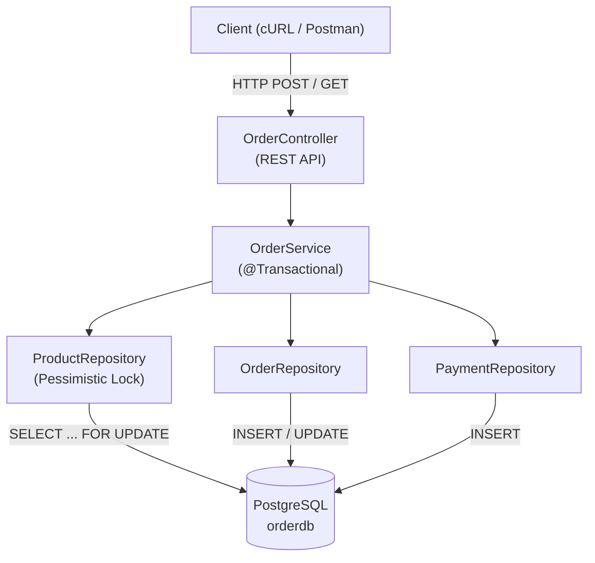
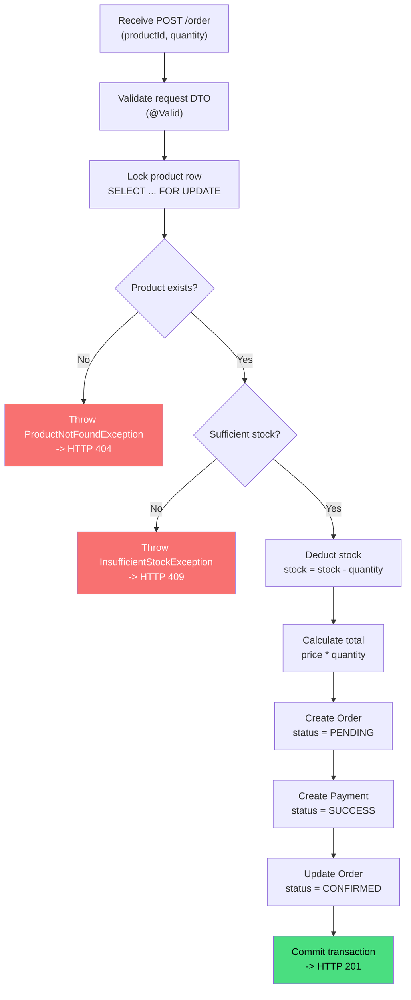
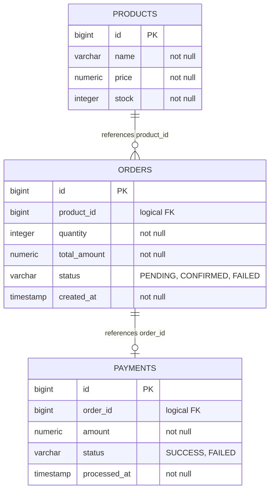
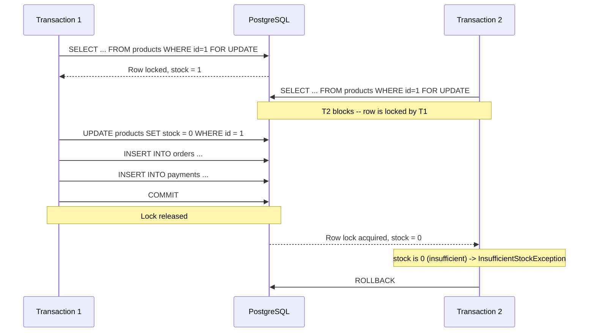

# Distributed Order Processing Engine — Phase 1

> **Monolithic Foundation** — A single Spring Boot application that handles order placement, inventory management, and payment processing within one ACID transaction, designed to be decomposed into microservices in Phase 2.

---

## Table of Contents

- [Key Features](#key-features)
- [Architecture Overview](#architecture-overview)
- [Technology Stack](#technology-stack)
- [Project Structure](#project-structure)
- [Order Processing Workflow](#order-processing-workflow)
- [Database Design](#database-design)
- [Concurrency Handling & Transaction Management](#concurrency-handling--transaction-management)
- [API Documentation](#api-documentation)
- [Prerequisites](#prerequisites)
- [Installation & Setup](#installation--setup)
- [PostgreSQL Configuration](#postgresql-configuration)
- [Running the Application](#running-the-application)
- [API Testing Examples](#api-testing-examples)
- [Error Handling](#error-handling)
- [Current Limitations](#current-limitations)
- [Phase 2 Roadmap](#phase-2-roadmap)

---

## Key Features

- **Single ACID Transaction** — order creation, stock deduction, and payment recording execute atomically; a failure at any step rolls back the entire operation.
- **Pessimistic Locking** — `SELECT … FOR UPDATE` on the product row prevents two concurrent orders from overselling the same inventory.
- **Lock Timeout** — a 5-second lock-acquisition timeout (`jakarta.persistence.lock.timeout=5000`) prevents threads from blocking indefinitely.
- **Clean Layer Separation** — controller → service → repository architecture with a dedicated request DTO so the API contract is decoupled from persistence entities.
- **Input Validation** — Jakarta Bean Validation (`@NotNull`, `@Min`) on the request DTO, enforced at the controller layer via `@Valid`.
- **Seed Data** — idempotent `data.sql` inserts starter products so the application is testable immediately after boot.
- **Environment-Variable Credentials** — database username and password are read from a `.env` file (git-ignored), keeping secrets out of source control.

---

## Architecture Overview

Phase 1 is a **modular monolith**. All domain concerns — orders, inventory, payments — live in a single deployable Spring Boot application and share one PostgreSQL database. This is intentional: it establishes the correct domain boundaries and data model before the complexity of inter-service communication is introduced in Phase 2.



> [!NOTE]
> **Note:** Although `spring-kafka` is present in the POM as a forward-looking dependency for Phase 2, **no Kafka producer or consumer is wired in Phase 1**. All communication is synchronous and in-process.

---

## Technology Stack

| Technology | Version | Purpose |
|---|---|---|
| **Java** | 17 | Language runtime (LTS release) |
| **Spring Boot** | 3.3.2 | Application framework, auto-configuration, embedded Tomcat |
| **Spring Data JPA** | _(managed by Boot)_ | Repository abstraction over Hibernate/JPA |
| **Hibernate** | _(managed by Boot)_ | ORM and DDL generation (`ddl-auto=update`) |
| **Spring Validation** | _(managed by Boot)_ | Bean Validation (Jakarta `@NotNull`, `@Min`) on request DTOs |
| **PostgreSQL** | 16+ recommended | Relational database; row-level locking via `FOR UPDATE` |
| **Jackson** | _(managed by Boot)_ | JSON serialization/deserialization, including `jackson-datatype-jsr310` for `Instant` fields |
| **Maven** | 3.8+ | Build tool and dependency management |
| **JUnit 5** | _(managed by Boot)_ | Test framework (context-load smoke test) |

---

## Project Structure

```
phase1/
├── .env.sample                 # Template for database credentials
├── .gitignore                  # Excludes .env, target/, .idea/
├── pom.xml                     # Maven build — Spring Boot 3.3.2, Java 17
│
└── src/
    ├── main/
    │   ├── java/com/example/order/
    │   │   ├── OrderApplication.java               # @SpringBootApplication entry point
    │   │   │
    │   │   ├── controller/
    │   │   │   ├── OrderController.java             # REST endpoints (POST /order, GET /order/{id})
    │   │   │   └── OrderRequest.java                # Request DTO with Jakarta validation
    │   │   │
    │   │   ├── entity/
    │   │   │   ├── Order.java                       # Order entity (orders table) with OrderStatus enum
    │   │   │   ├── Payment.java                     # Payment entity (payments table) with PaymentStatus enum
    │   │   │   └── Product.java                     # Product entity (products table) — inventory tracked via stock field
    │   │   │
    │   │   ├── repository/
    │   │   │   ├── OrderRepository.java             # JpaRepository<Order, Long>
    │   │   │   ├── PaymentRepository.java           # JpaRepository<Payment, Long>
    │   │   │   └── ProductRepository.java           # findByIdForUpdate() — PESSIMISTIC_WRITE lock
    │   │   │
    │   │   └── service/
    │   │       ├── OrderService.java                # Core business logic; @Transactional placeOrder()
    │   │       ├── InsufficientStockException.java  # Thrown when requested quantity > available stock
    │   │       └── ProductNotFoundException.java    # Thrown when productId does not exist
    │   │
    │   └── resources/
    │       ├── application.properties               # Datasource, JPA, server-port config
    │       └── data.sql                             # Seed data — two starter products
    │
    └── test/
        └── java/com/example/order/
            └── OrderApplicationTests.java           # Spring context-load smoke test
```

---

## Order Processing Workflow

Every call to `POST /order` executes the following steps inside a single database transaction:



### Step-by-Step Breakdown

| Step | Operation | Detail |
|---|---|---|
| 1 | **Validate input** | `@Valid` triggers Jakarta Bean Validation on `OrderRequest` — rejects null `productId` or `quantity < 1`. |
| 2 | **Acquire row lock** | `ProductRepository.findByIdForUpdate()` issues `SELECT … FROM products WHERE id = ? FOR UPDATE`, acquiring a pessimistic write lock on the product row. |
| 3 | **Check stock** | While holding the lock, verify `product.stock >= quantity`. If not, throw `InsufficientStockException` (rolls back the transaction). |
| 4 | **Deduct stock** | `product.setStock(product.getStock() - quantity)` → `productRepository.save(product)`. The row lock ensures no other transaction can read a stale stock value. |
| 5 | **Create order** | Insert a new `Order` row with status `PENDING` and `totalAmount = price × quantity`. |
| 6 | **Record payment** | Insert a `Payment` row referencing the new order ID, with status `SUCCESS`. |
| 7 | **Confirm order** | Update the order status from `PENDING` → `CONFIRMED`. |
| 8 | **Commit** | Spring commits the transaction. The row lock is released. |

> [!IMPORTANT]
> **Important:** If **any** step throws a runtime exception, Spring's `@Transactional` proxy rolls back the entire transaction -- stock is restored, and no orphaned order or payment row exists.

---

## Database Design

Hibernate auto-generates the schema from JPA annotations (`spring.jpa.hibernate.ddl-auto=update`). Below is the resulting table layout.

### Entity-Relationship Diagram



> [!NOTE]
> **Note:** `product_id` in `orders` and `order_id` in `payments` are **logical foreign keys** -- they store the related ID, but no physical `@ManyToOne` / `@JoinColumn` constraint is defined in the JPA entities. This is a deliberate design choice that simplifies the eventual decomposition into separate services with separate databases.

### Seed Data

On every startup, `data.sql` inserts two products (idempotently, using `WHERE NOT EXISTS`):

| ID (auto) | Name | Price | Stock |
|---|---|---|---|
| 1 | Wireless Mouse | 25.99 | 10 |
| 2 | Mechanical Keyboard | 89.50 | 5 |

---

## Concurrency Handling & Transaction Management

### Why Pessimistic Locking?

Without locking, two concurrent requests for the last unit of a product can both read `stock = 1`, both pass the stock check, and both deduct — resulting in `stock = -1`. This is a classic **lost-update** / **write-skew** problem.

Phase 1 solves this with **pessimistic locking** (`SELECT … FOR UPDATE`):



### Key Configuration

```properties
# Fail fast instead of hanging forever if a row lock can't be acquired
spring.jpa.properties.jakarta.persistence.lock.timeout=5000
```

If a lock cannot be acquired within 5 seconds, the database throws an exception instead of blocking indefinitely. This prevents thread starvation under high contention.

### Transaction Scope

| Method | Annotation | Behaviour |
|---|---|---|
| `OrderService.placeOrder()` | `@Transactional` | Read-write; full ACID guarantees; rolls back on any `RuntimeException` |
| `OrderService.findById()` | `@Transactional(readOnly = true)` | Read-only; Hibernate flushes nothing, allows DB-level read optimisations |

---

## API Documentation

**Base URL:** `http://localhost:8080`

### Endpoints

| Method | Endpoint | Description | Success Code | Error Codes |
|---|---|---|---|---|
| `POST` | `/order` | Place a new order | `201 Created` | `400`, `404`, `409` |
| `GET` | `/order/{id}` | Retrieve an order by ID | `200 OK` | `404` |

---

### `POST /order` — Place Order

**Request Body:**

```json
{
  "productId": 1,
  "quantity": 2
}
```

| Field | Type | Constraints | Description |
|---|---|---|---|
| `productId` | `Long` | Required, not null | ID of the product to purchase |
| `quantity` | `Integer` | Required, not null, ≥ 1 | Number of units to order |

**Success Response — `201 Created`:**

```json
{
  "id": 1,
  "productId": 1,
  "quantity": 2,
  "totalAmount": 51.98,
  "status": "CONFIRMED",
  "createdAt": "2026-11-13T12:22:03.456789Z"
}
```

**Error Response — `404 Not Found` (product does not exist):**

```json
{
  "timestamp": "2026-11-13T12:22:03.456+00:00",
  "status": 404,
  "error": "Not Found",
  "message": "No product with id 99",
  "path": "/order"
}
```

**Error Response — `409 Conflict` (insufficient stock):**

```json
{
  "timestamp": "2026-11-13T12:22:03.456+00:00",
  "status": 409,
  "error": "Conflict",
  "message": "Only 0 units left for product 1",
  "path": "/order"
}
```

---

### `GET /order/{id}` — Get Order

**Success Response — `200 OK`:**

```json
{
  "id": 1,
  "productId": 1,
  "quantity": 2,
  "totalAmount": 51.98,
  "status": "CONFIRMED",
  "createdAt": "2026-11-13T12:22:03.456789Z"
}
```

**Error Response — `404 Not Found`:**

```json
{
  "timestamp": "2026-11-13T12:22:03.456+00:00",
  "status": 404,
  "error": "Not Found",
  "message": "No order with id 99",
  "path": "/order/99"
}
```

---

## Prerequisites

- **Java 17** or later ([Eclipse Temurin](https://adoptium.net/) recommended)
- **Maven 3.8+** (or use the Maven wrapper if present)
- **PostgreSQL 16+** running on `localhost:5432`

---

## Installation & Setup

```bash
# 1. Clone the repository
git clone <repository-url>
cd distributed-order-processing-engine/phase1

# 2. Create the environment file from the template
cp .env.sample .env

# 3. Edit .env and set your PostgreSQL credentials
#    DB_USERNAME=postgres
#    DB_PASSWORD=your_password
```

---

## PostgreSQL Configuration

### Create the Database

```sql
CREATE DATABASE orderdb;
```

The application uses `spring.jpa.hibernate.ddl-auto=update`, so tables (`products`, `orders`, `payments`) are created or updated automatically on startup. No manual DDL is required.

### Connection Settings

Configured in `application.properties`:

```properties
spring.datasource.url=jdbc:postgresql://localhost:5432/orderdb
spring.datasource.username=${DB_USERNAME}
spring.datasource.password=${DB_PASSWORD}
spring.datasource.driver-class-name=org.postgresql.Driver
```

`DB_USERNAME` and `DB_PASSWORD` are resolved from the `.env` file at runtime.

> [!TIP]
> **Tip:** You can spin up PostgreSQL quickly via Docker using the command below.

```bash
docker run -d --name orderdb \
  -p 5432:5432 \
  -e POSTGRES_DB=orderdb \
  -e POSTGRES_PASSWORD=postgres \
  postgres:16
```

---

## Running the Application

```bash
# Build and run
mvn spring-boot:run

# Or build the JAR and run it
mvn clean package -DskipTests
java -jar target/order-service-1.0.0.jar
```

The application starts on **port 8080** by default. On successful startup you will see Hibernate DDL output followed by `data.sql` seed inserts in the console.

---

## API Testing Examples

### Using cURL

**Place an order:**

```bash
curl -X POST http://localhost:8080/order \
  -H "Content-Type: application/json" \
  -d '{"productId": 1, "quantity": 2}'
```

**Retrieve an order:**

```bash
curl http://localhost:8080/order/1
```

**Trigger a 404 (non-existent product):**

```bash
curl -X POST http://localhost:8080/order \
  -H "Content-Type: application/json" \
  -d '{"productId": 999, "quantity": 1}'
```

**Trigger a 409 (insufficient stock):**

```bash
curl -X POST http://localhost:8080/order \
  -H "Content-Type: application/json" \
  -d '{"productId": 2, "quantity": 100}'
```

### Test Concurrency

Send two simultaneous requests for the last unit. One should succeed; the other should receive a `409 Conflict`:

```bash
# Terminal 1
curl -X POST http://localhost:8080/order \
  -H "Content-Type: application/json" \
  -d '{"productId": 2, "quantity": 5}'

# Terminal 2 (run at the same time)
curl -X POST http://localhost:8080/order \
  -H "Content-Type: application/json" \
  -d '{"productId": 2, "quantity": 5}'
```

The pessimistic lock ensures only one transaction succeeds. The other will either wait (up to 5 seconds for the lock) and then fail with insufficient stock, or time out.

---

## Error Handling

| Scenario | Exception | HTTP Status | Response Message Example |
|---|---|---|---|
| Product ID does not exist | `ProductNotFoundException` | `404 Not Found` | `No product with id 99` |
| Requested quantity exceeds available stock | `InsufficientStockException` | `409 Conflict` | `Only 3 units left for product 1` |
| Missing or invalid request fields | Jakarta Validation (`MethodArgumentNotValidException`) | `400 Bad Request` | `productId is required` / `quantity must be at least 1` |
| Order ID does not exist (GET) | `ResponseStatusException` | `404 Not Found` | `No order with id 99` |
| Lock acquisition timeout (5 s) | `PessimisticLockException` | `500 Internal Server Error` | Default Spring Boot error response |

### Implementation Details

- `ProductNotFoundException` and `InsufficientStockException` are **unchecked exceptions** (`RuntimeException`), which ensures Spring's `@Transactional` proxy rolls back the transaction automatically.
- The controller catches these domain exceptions and re-throws them as `ResponseStatusException` with the appropriate HTTP status code.
- Validation errors are handled by Spring's default `MethodArgumentNotValidException` handler, returning `400 Bad Request`.

---

## Current Limitations

| Area | Limitation |
|---|---|
| **No global exception handler** | Exceptions are caught locally in the controller using try-catch and `ResponseStatusException`. A `@RestControllerAdvice` would provide more structured, consistent error responses. |
| **Payment is always successful** | The payment step creates a `Payment` row with `status = SUCCESS` unconditionally. There is no payment failure simulation or integration with an external payment gateway. |
| **No product management APIs** | Products can only be seeded via `data.sql`. There are no REST endpoints to create, update, list, or delete products. |
| **No order listing endpoint** | Only `GET /order/{id}` exists. There is no `GET /order` to list all orders, paginate, or filter. |
| **Logical foreign keys only** | `product_id` and `order_id` are stored as plain `Long` columns with no JPA relationship annotations (`@ManyToOne`) or database-level foreign key constraints. |
| **No authentication or authorisation** | All endpoints are publicly accessible. There is no Spring Security integration. |
| **Schema managed by Hibernate** | `ddl-auto=update` is convenient for development but is not production-safe. Schema changes should be managed by a migration tool (Flyway or Liquibase). |
| **Single integration test** | Only a context-load smoke test exists. There are no unit tests for the service layer or integration tests for the API endpoints. |
| **`FAILED` status unused** | `Order.OrderStatus.FAILED` is declared in the enum but is never set in code, since payment always succeeds. |

---

## Phase 2 Roadmap

Phase 2 decomposes this monolith into independent microservices communicating via events. Planned changes include:

| Area | Phase 2 Direction |
|---|---|
| **Architecture** | Split into 3 services: Order Service, Payment Service, Inventory Service — each with its own database. |
| **Messaging** | Apache Kafka for asynchronous, event-driven communication between services (the `spring-kafka` dependency is already present). |
| **Saga Pattern** | Choreography or orchestration-based saga to coordinate cross-service transactions with compensating actions (e.g., stock rollback on payment failure). |
| **Payment Simulation** | Introduce payment failure scenarios and compensation logic (refund, stock restoration). |
| **API Gateway** | Centralized entry point for routing, authentication, and rate limiting. |
| **Service Discovery** | Eureka or Kubernetes-based service registration and discovery. |
| **Containerization** | Docker Compose for local multi-service development; Kubernetes manifests for production deployment. |
| **Resilience** | Circuit breakers, retries, and dead-letter queues to handle downstream service failures. |
| **Testing** | Contract tests, integration tests with Testcontainers, and end-to-end saga verification. |

---

<p align="center">
  <sub>Phase 1 — Monolithic Foundation · Built with Spring Boot 3.3.2 & Java 17</sub>
</p>

