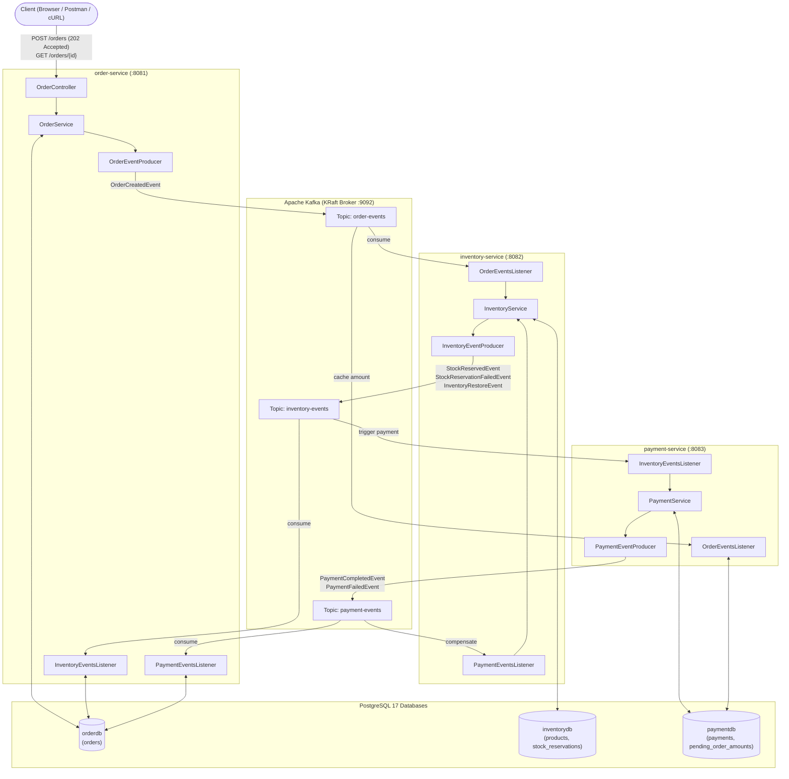
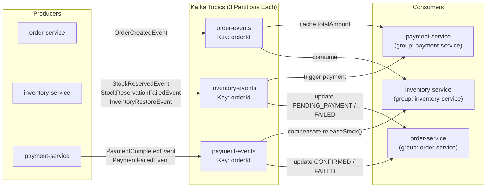
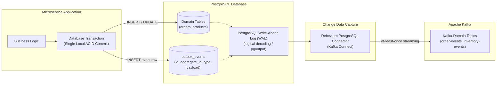
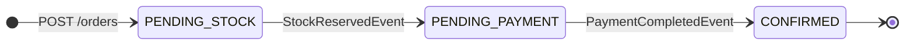
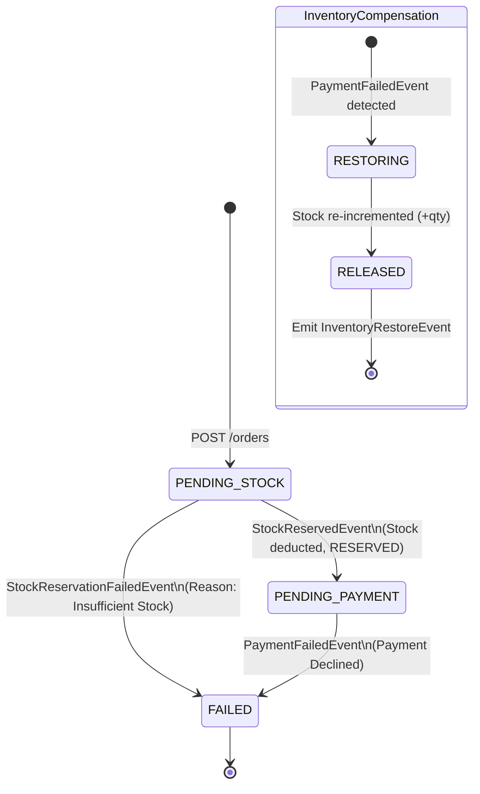
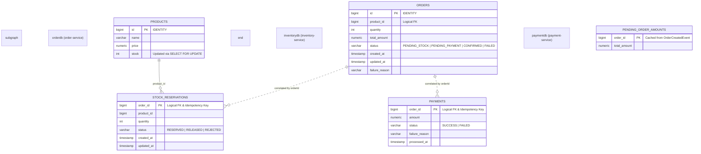

# Distributed Order Processing Engine — Phase 2

> **Event-Driven Choreographed Saga Architecture** — An asynchronous, distributed order processing system decomposing the Phase 1 monolith into independent microservices communicating via Apache Kafka, featuring transactional database-per-service isolation, choreographed sagas with compensating rollbacks, and pessimistic concurrency control.

---

## Table of Contents

- [Overview](#overview)
- [Evolution from Phase 1 to Phase 2](#evolution-from-phase-1-to-phase-2)
- [Phase 1 vs. Phase 2 Architectural Comparison](#phase-1-vs-phase-2-architectural-comparison)
- [Key Features](#key-features)
- [Architecture Overview](#architecture-overview)
- [Technology Stack](#technology-stack)
- [Microservices & Responsibilities](#microservices--responsibilities)
- [Project Directory Structure](#project-directory-structure)
- [System Architecture Diagram](#system-architecture-diagram)
- [End-to-End Order Processing Workflow](#end-to-end-order-processing-workflow)
- [Kafka Event Flow & Topic Topology](#kafka-event-flow--topic-topology)
- [Transactional Outbox & CDC Pipeline Analysis](#transactional-outbox--cdc-pipeline-analysis)
- [Saga Pattern & Compensating Transactions](#saga-pattern--compensating-transactions)
- [Database Architecture](#database-architecture)
- [Redis Integration Analysis](#redis-integration-analysis)
- [REST API Documentation](#rest-api-documentation)
- [Docker Infrastructure & Services](#docker-infrastructure--services)
- [Prerequisites](#prerequisites)
- [Environment Variables & Configuration](#environment-variables--configuration)
- [Step-by-Step Local Setup](#step-by-step-local-setup)
- [How to Start All Services](#how-to-start-all-services)
- [API Testing Examples via cURL](#api-testing-examples-via-curl)
- [How to Monitor Kafka & Application Logs](#how-to-monitor-kafka--application-logs)
- [Error Handling & Reliability Considerations](#error-handling--reliability-considerations)
- [Current Limitations](#current-limitations)
- [Future Improvements & Phase 3 Roadmap](#future-improvements--phase-3-roadmap)

---

## Overview

The **Distributed Order Processing Engine (Phase 2)** represents the architectural decomposition of a single-process Spring Boot monolith (Phase 1) into an **asynchronous, event-driven distributed system**. 

In distributed systems, executing business transactions across multiple service boundaries cannot rely on traditional two-phase commit (2PC) or distributed database locks due to severe availability bottlenecks and network latency (as governed by the CAP theorem). Phase 2 addresses this challenge by adopting:
- **Database-per-Service pattern** to ensure domain autonomy.
- **Choreographed Saga pattern** for cross-service workflow coordination.
- **Compensating transactions** to restore state consistency when downstream operations fail.
- **Transactional post-commit event publishing** via Spring's `TransactionSynchronizationManager` to eliminate "ghost events" on database rollbacks.
- **Idempotent message consumers** to protect against duplicate deliveries inherent in Kafka's at-least-once processing guarantee.

---

## Evolution from Phase 1 to Phase 2

In **Phase 1**, all business capabilities (order management, stock deduction, and payment authorization) operated within a single application process and a single database transaction. If any sub-operation threw an exception, Spring's `@Transactional` rollback mechanism atomically reverted the order, payment, and inventory changes simultaneously.

In **Phase 2**, the monolith is divided into three autonomous microservices:
1. **`order-service`**: Acts as the saga initiator. It validates incoming orders, persists an initial pending record, and delegates processing to downstream services via asynchronous events.
2. **`inventory-service`**: Owns product catalog data and inventory quantities. It validates and reserves stock using pessimistic locking, and exposes a compensating rollback mechanism.
3. **`payment-service`**: Simulates charge authorization, supports configurable failure injection for failure testing, and triggers sagas to confirm or compensate.

Services communicate entirely asynchronously over **Apache Kafka (KRaft mode)** without direct HTTP inter-service coupling.

---

## Phase 1 vs. Phase 2 Architectural Comparison

| Dimension | Phase 1 (Monolith) | Phase 2 (Distributed Event-Driven) |
|---|---|---|
| **Architecture** | Single-tier modular monolith | Distributed microservices architecture |
| **Service Organization** | All domain packages inside one JAR | 3 decoupled services (`order`, `inventory`, `payment`) |
| **Communication** | In-process synchronous Java method calls | Asynchronous event publishing via Apache Kafka |
| **Database Design** | Shared PostgreSQL database (`orderdb`) | Database-per-Service (`orderdb`, `inventorydb`, `paymentdb`) |
| **Transaction Boundary** | Single ACID local database transaction | Distributed eventual consistency managed by a Choreographed Saga |
| **Concurrency Control** | `SELECT ... FOR UPDATE` in monolithic service | Pessimistic locking inside `inventory-service` + Idempotency tables |
| **Rollback Mechanism** | Automatic database transaction rollback | Explicit compensating transactions (e.g., `releaseStock()`) |
| **Client Interaction** | Synchronous `201 Created` / immediate failure | Asynchronous `202 Accepted` + polling `GET /orders/{id}` |
| **Fault Tolerance** | Single point of failure (process-level) | Resilient: failure in payment triggers automated saga compensation |
| **Scalability** | Scale monolith as a single unit | Independent horizontal scalability per service and partition |
| **Event Mapping** | None (direct entity manipulation) | Decoupled cross-service event types via `JsonDeserializer` type mappings |

---

## Key Features

- **Choreographed Saga Orchestration**: No centralized coordinator orchestrates the workflow; services react independently to domain events published to Kafka topics.
- **Automated Compensating Rollback**: When a payment fails (e.g., card declined or simulated failure), an automated compensating transaction restores reserved warehouse stock.
- **Database-per-Service Isolation**: Each service connects to its own independent database schema (`orderdb`, `inventorydb`, `paymentdb`), strictly preventing cross-service data coupling.
- **Pessimistic Row-Level Concurrency**: Inventory updates are guarded by `SELECT ... FOR UPDATE` with a 5-second lock timeout, preventing inventory overselling under high concurrency.
- **At-Least-Once Delivery Idempotency**: Services employ dedicated tracking tables (`stock_reservations`, `payments`, `pending_order_amounts`) to safely discard duplicate Kafka event deliveries.
- **Post-Commit Event Publication**: Events are only dispatched to Kafka brokers after local database transactions successfully commit, eliminating phantom events.
- **Deterministic & Random Failure Injection**: The payment service supports deterministic failure targeting via `--payment.failing-product-ids=<id>` and probabilistic random failures for chaos testing.
- **Local Developer Ergonomics**: Complete Docker Compose infrastructure for PostgreSQL 17, Apache Kafka 3.8 (KRaft mode), and Kafka UI, paired with automated end-to-end saga test scripts.

---

## Architecture Overview



---

## Technology Stack

| Technology | Version | Purpose |
|---|---|---|
| **Java** | 17 | Core language runtime (LTS) |
| **Spring Boot** | 3.3.2 | Application framework, dependency injection, embedded Tomcat |
| **Spring Data JPA / Hibernate** | 3.3.2 | ORM, query execution, and database schema migration |
| **Spring Kafka** | 3.2.2 | Asynchronous messaging, listener containers, error handling deserializers |
| **Apache Kafka** | 3.8.0 | Distributed event streaming platform running in KRaft mode (no ZooKeeper) |
| **Kafka UI** | latest | Web-based management console for inspecting topics, consumers, and messages |
| **PostgreSQL** | 17 | Relational persistence backing database-per-service isolation |
| **Spring Dotenv** | 4.0.0 | Loads environment variables from `.env` files into Spring properties |
| **Jakarta Validation** | 3.0.2 | DTO input validation (`@NotNull`, `@Min`, `@DecimalMin`) |
| **Docker & Compose** | v2+ | Multi-container local orchestration for PostgreSQL, Kafka, and Kafka UI |
| **JUnit 5 & Mockito** | 5.10.x | Unit and slice integration testing for services and Kafka listeners |

---

## Microservices & Responsibilities

### 1. Order Service (`order-service` — Port 8081)
- **Role**: Saga Initiator & Order Lifecycle Manager.
- **REST Endpoints**: Exposes `POST /orders` and `GET /orders/{id}`.
- **State Machine**: Tracks order state transitions:
  - `PENDING_STOCK` — Initial state after client submission.
  - `PENDING_PAYMENT` — Stock has been confirmed and reserved.
  - `CONFIRMED` — Payment authorized; order successfully completed.
  - `FAILED` — Either inventory reservation failed or payment failed.
- **Persistence**: Manages the `orders` table in `orderdb`.
- **Event Responsibilities**:
  - Produces: `OrderCreatedEvent` to `order-events`.
  - Consumes: `StockReservedEvent`, `StockReservationFailedEvent`, `InventoryRestoreEvent` from `inventory-events`.
  - Consumes: `PaymentCompletedEvent`, `PaymentFailedEvent` from `payment-events`.

### 2. Inventory Service (`inventory-service` — Port 8082)
- **Role**: Stock Manager & Compensating Transaction Executor.
- **REST Endpoints**: None (purely event-driven worker).
- **Concurrency & Locking**: Executes `SELECT ... FOR UPDATE` against the `products` table in `inventorydb` to ensure serialize-isolated inventory updates.
- **Idempotency**: Maintains `stock_reservations` (`RESERVED`, `RELEASED`, `REJECTED`) keyed by `orderId`.
- **Compensation**: When `PaymentFailedEvent` arrives, executes `releaseStock(orderId)`, atomically increments product stock, transitions reservation to `RELEASED`, and emits `InventoryRestoreEvent`.
- **Event Responsibilities**:
  - Consumes: `OrderCreatedEvent` from `order-events`.
  - Consumes: `PaymentFailedEvent`, `PaymentCompletedEvent` from `payment-events`.
  - Produces: `StockReservedEvent`, `StockReservationFailedEvent`, `InventoryRestoreEvent` to `inventory-events`.

### 3. Payment Service (`payment-service` — Port 8083)
- **Role**: Payment Authorization & Failure Simulation Engine.
- **REST Endpoints**: None (purely event-driven worker).
- **Idempotency**: Persists payment records keyed by `orderId` in `paymentdb` to prevent double-charging on duplicate deliveries.
- **Amount Correlation**: Caches `totalAmount` via `pending_order_amounts` upon receiving `OrderCreatedEvent`, enabling decoupled payment processing when `StockReservedEvent` arrives.
- **Fault Injection**:
  - Deterministic failure for configured product IDs via `payment.failing-product-ids`.
  - Random probabilistic failure via `payment.random-failure-enabled` and `payment.random-failure-rate`.
- **Event Responsibilities**:
  - Consumes: `OrderCreatedEvent` from `order-events` (caches amount).
  - Consumes: `StockReservedEvent` from `inventory-events` (triggers payment).
  - Produces: `PaymentCompletedEvent`, `PaymentFailedEvent` to `payment-events`.

---

## Project Directory Structure

```
phase2/
├── .env                              # Active environment configuration (git-ignored)
├── .env.sample                       # Template for environment configuration
├── .gitignore                        # Git ignore patterns (.env, *.log, target/)
├── docker-compose.yml                # Infrastructure: PostgreSQL 17, Kafka 3.8 KRaft, Kafka UI
├── init-db.sql                       # Database initialization: creates inventorydb and paymentdb
├── test-e2e-saga.ps1                 # Automated 3-scenario end-to-end test script (PowerShell)
├── test-e2e-saga.sh                  # Automated 3-scenario end-to-end test script (Bash)
│
├── order-service/                    # [Service 1] Saga Initiator (Port 8081)
│   ├── pom.xml                       # Maven build: Web, JPA, Kafka, Validation, Dotenv
│   └── src/
│       ├── main/
│       │   ├── java/com/example/order/
│       │   │   ├── OrderApplication.java               # Spring Boot entry point
│       │   │   ├── config/
│       │   │   │   └── DataSourceDiagnostics.java      # Startup JDBC logging
│       │   │   ├── controller/
│       │   │   │   ├── OrderController.java            # POST /orders, GET /orders/{id}
│       │   │   │   └── OrderRequest.java               # Validation DTO (productId, quantity, unitPrice)
│       │   │   ├── entity/
│       │   │   │   └── Order.java                      # Order entity with OrderStatus enum
│       │   │   ├── event/                              # Event POJOs (OrderCreated, StockReserved, etc.)
│       │   │   ├── messaging/
│       │   │   │   ├── KafkaConsumerConfig.java        # Logical type mapping deserializer
│       │   │   │   ├── KafkaProducerConfig.java        # JSON serializer with type mappings
│       │   │   │   ├── KafkaTopicConfig.java           # Topic bean: order-events (3 partitions)
│       │   │   │   ├── OrderEventProducer.java         # Post-commit transactional publisher
│       │   │   │   ├── InventoryEventsListener.java    # Handles StockReserved / StockReservationFailed
│       │   │   │   └── PaymentEventsListener.java      # Handles PaymentCompleted / PaymentFailed
│       │   │   ├── repository/
│       │   │   │   └── OrderRepository.java            # JpaRepository<Order, Long>
│       │   │   └── service/
│       │   │       └── OrderService.java               # Transactional placeOrder() logic
│       │   └── resources/
│       │       └── application.properties              # Port 8081, orderdb datasource, Kafka broker
│       └── test/
│           └── java/com/example/order/
│               ├── OrderApplicationTests.java         # Spring context smoke test
│               └── OrderServiceTest.java              # Unit tests for state transitions & events
│
├── inventory-service/                # [Service 2] Stock & Compensation (Port 8082)
│   ├── pom.xml
│   └── src/
│       ├── main/
│       │   ├── java/com/example/inventory/
│       │   │   ├── InventoryApplication.java
│       │   │   ├── config/
│       │   │   │   └── DataSourceDiagnostics.java
│       │   │   ├── entity/
│       │   │   │   ├── Product.java                    # Products catalog (id, name, price, stock)
│       │   │   │   └── StockReservation.java           # Idempotency table (RESERVED/RELEASED/REJECTED)
│       │   │   ├── event/                              # Event POJOs
│       │   │   ├── messaging/
│       │   │   │   ├── KafkaConsumerConfig.java
│       │   │   │   ├── KafkaProducerConfig.java
│       │   │   │   ├── KafkaTopicConfig.java           # Topic bean: inventory-events (3 partitions)
│       │   │   │   ├── InventoryEventProducer.java     # Post-commit publisher
│       │   │   │   ├── OrderEventsListener.java        # Consumes OrderCreatedEvent -> reserveStock
│       │   │   │   └── PaymentEventsListener.java      # Consumes PaymentFailedEvent -> releaseStock
│       │   │   ├── repository/
│       │   │   │   ├── ProductRepository.java          # Pessimistic locking findByIdForUpdate()
│       │   │   │   └── StockReservationRepository.java # JpaRepository<StockReservation, Long>
│       │   │   └── service/
│       │   │       └── InventoryService.java           # reserveStock() and releaseStock() logic
│       │   └── resources/
│       │       ├── application.properties              # Port 8082, inventorydb, lock timeout 5000ms
│       │       └── data.sql                            # Seed catalog: Wireless Mouse & Mechanical Keyboard
│       └── test/
│           └── java/com/example/inventory/
│               ├── InventoryApplicationTests.java
│               ├── InventoryEventProducerTest.java     # Verifies post-commit & rollback isolation
│               └── InventoryServiceTest.java           # Tests reserve, reject, compensation & idempotency
│
└── payment-service/                  # [Service 3] Payment & Fault Injection (Port 8083)
    ├── pom.xml
    └── src/
        ├── main/
        │   ├── java/com/example/payment/
        │   │   ├── PaymentApplication.java
        │   │   ├── config/
        │   │   │   └── DataSourceDiagnostics.java
        │   │   ├── entity/
        │   │   │   ├── Payment.java                    # Payment entity (orderId PK, amount, status)
        │   │   │   └── PendingOrderAmount.java         # Cache table correlating orderId -> totalAmount
        │   │   ├── event/                              # Event POJOs
        │   │   │   ├── OrderCreatedEvent.java
        │   │   │   ├── StockReservedEvent.java
        │   │   │   ├── PaymentCompletedEvent.java
        │   │   │   └── PaymentFailedEvent.java
        │   │   ├── messaging/
        │   │   │   ├── KafkaConsumerConfig.java
        │   │   │   ├── KafkaProducerConfig.java
        │   │   │   ├── KafkaTopicConfig.java           # Topic bean: payment-events (3 partitions)
        │   │   │   ├── PaymentEventProducer.java       # Post-commit publisher
        │   │   │   ├── InventoryEventsListener.java    # Consumes StockReservedEvent -> processPayment
        │   │   │   └── OrderEventsListener.java        # Consumes OrderCreatedEvent -> caches amount
        │   │   ├── repository/
        │   │   │   ├── PaymentRepository.java          # JpaRepository<Payment, Long>
        │   │   │   └── PendingOrderAmountRepository.java
        │   │   └── service/
        │   │       └── PaymentService.java             # processPayment() with failure injection
        │   └── resources/
        │       └── application.properties              # Port 8083, paymentdb, failure injection flags
        └── test/
            └── java/com/example/payment/
                ├── PaymentApplicationTests.java
                └── PaymentServiceTest.java             # Tests success, failure injection, idempotency
```

---

## System Architecture Diagram

```mermaid
sequenceDiagram
    autonumber
    actor Client
    participant OrderService as order-service (:8081)
    participant Kafka as Apache Kafka (:9092)
    participant InventoryService as inventory-service (:8082)
    participant PaymentService as payment-service (:8083)

    Client->>OrderService: POST /orders {productId: 1, quantity: 2, unitPrice: 25.99}
    OrderService->>OrderService: Insert Order (status = PENDING_STOCK) in orderdb
    OrderService-->>Client: 202 Accepted {id: 101, status: "PENDING_STOCK"}

    Note over OrderService,Kafka: Transaction commits; post-commit hook triggers event
    OrderService->>Kafka: Publish OrderCreatedEvent to 'order-events'

    par Parallel Kafka Consumer Broadcast
        Kafka->>InventoryService: Consume OrderCreatedEvent
        Kafka->>PaymentService: Consume OrderCreatedEvent (cache amount in pending_order_amounts)
    end

    critical Inventory Reservation (Pessimistic Lock)
        InventoryService->>InventoryService: SELECT ... FOR UPDATE (Product #1)
        InventoryService->>InventoryService: stock -= 2; insert StockReservation (RESERVED)
    end

    InventoryService->>Kafka: Publish StockReservedEvent to 'inventory-events'

    par Parallel Reaction to StockReservedEvent
        Kafka->>OrderService: Consume StockReservedEvent
        OrderService->>OrderService: Update Order #101 status -> PENDING_PAYMENT
    and
        Kafka->>PaymentService: Consume StockReservedEvent
        PaymentService->>PaymentService: Lookup cached amount & evaluate failure rules
    end

    alt Payment Succeeded (Happy Path)
        PaymentService->>PaymentService: Insert Payment (status = SUCCESS) in paymentdb
        PaymentService->>Kafka: Publish PaymentCompletedEvent to 'payment-events'
        Kafka->>OrderService: Consume PaymentCompletedEvent
        OrderService->>OrderService: Update Order #101 status -> CONFIRMED
    else Payment Failed (Compensating Rollback Path)
        PaymentService->>PaymentService: Insert Payment (status = FAILED) in paymentdb
        PaymentService->>Kafka: Publish PaymentFailedEvent to 'payment-events'
        
        par Parallel Compensation Reactions
            Kafka->>OrderService: Consume PaymentFailedEvent
            OrderService->>OrderService: Update Order #101 status -> FAILED
        and
            Kafka->>InventoryService: Consume PaymentFailedEvent (Compensating Tx)
            InventoryService->>InventoryService: SELECT ... FOR UPDATE (Product #1)
            InventoryService->>InventoryService: stock += 2 (restore stock)
            InventoryService->>InventoryService: Update StockReservation -> RELEASED
            InventoryService->>Kafka: Publish InventoryRestoreEvent to 'inventory-events'
        end
    end
```

---

## End-to-End Order Processing Workflow

### 1. Happy Path Execution
1. **Submission**: The client sends a `POST /orders` payload.
2. **Order Intake**: `OrderService` inserts an `Order` with status `PENDING_STOCK` into `orderdb` and returns HTTP `202 Accepted`.
3. **Commit & Publish**: Upon transaction commit, `OrderEventProducer` publishes `OrderCreatedEvent` to the `order-events` topic.
4. **Amount Caching**: `PaymentService` consumes `OrderCreatedEvent` and inserts a `PendingOrderAmount` record into `paymentdb`.
5. **Stock Deduction**: `InventoryService` consumes `OrderCreatedEvent`, acquires a row lock (`SELECT ... FOR UPDATE`), deducts available stock, inserts a `StockReservation` with status `RESERVED`, and publishes `StockReservedEvent` to `inventory-events`.
6. **State Advancement**: `OrderService` consumes `StockReservedEvent` and updates order status to `PENDING_PAYMENT`.
7. **Payment Authorization**: `PaymentService` consumes `StockReservedEvent`, retrieves the cached amount, checks failure rules, records a `Payment` with status `SUCCESS`, and publishes `PaymentCompletedEvent` to `payment-events`.
8. **Final Confirmation**: `OrderService` consumes `PaymentCompletedEvent` and marks the order as `CONFIRMED`.

### 2. Failure Path: Insufficient Stock
1. The client places an order exceeding available stock.
2. `InventoryService` acquires the row lock, detects `product.stock < quantity`, logs the rejection, inserts a `StockReservation` with status `REJECTED`, and publishes `StockReservationFailedEvent` to `inventory-events`.
3. `OrderService` consumes `StockReservationFailedEvent`, updates the order status directly to `FAILED`, and records the specific `failureReason`.
4. No payment operations or compensations occur because payment was never triggered.

### 3. Failure Path: Payment Failure & Compensating Rollback
1. Stock is reserved successfully by `InventoryService` (`stock_reservations` = `RESERVED`).
2. `PaymentService` encounters a failure condition (e.g., target `productId` configured in `payment.failing-product-ids`).
3. `PaymentService` records a `Payment` with status `FAILED` and publishes `PaymentFailedEvent` to `payment-events`.
4. **Order Service Reaction**: `OrderService` marks the order `FAILED` with `failureReason = "Payment declined..."`.
5. **Inventory Service Compensation**: `InventoryService` consumes `PaymentFailedEvent`, verifies that the reservation was in `RESERVED` status, locks the product row, increments stock back by the reserved quantity (`stock += quantity`), updates reservation status to `RELEASED`, and publishes `InventoryRestoreEvent`.
6. System consistency is fully restored.

---

## Kafka Event Flow & Topic Topology

All Kafka topics are configured with **3 partitions** and a **replication factor of 1** (via `KafkaTopicConfig` using Spring's `TopicBuilder`).



### Event Contracts and Payloads

#### 1. `OrderCreatedEvent`
- **Topic**: `order-events`
- **Producer**: `order-service`
- **Consumers**: `inventory-service`, `payment-service`
```json
{
  "orderId": 101,
  "productId": 1,
  "quantity": 2,
  "totalAmount": 51.98,
  "occurredAt": "2026-11-13T12:00:00Z"
}
```

#### 2. `StockReservedEvent`
- **Topic**: `inventory-events`
- **Producer**: `inventory-service`
- **Consumers**: `order-service`, `payment-service`
```json
{
  "orderId": 101,
  "productId": 1,
  "quantity": 2,
  "totalAmount": 51.98,
  "occurredAt": "2026-11-13T12:00:01Z"
}
```

#### 3. `StockReservationFailedEvent`
- **Topic**: `inventory-events`
- **Producer**: `inventory-service`
- **Consumers**: `order-service`
```json
{
  "orderId": 102,
  "productId": 1,
  "reason": "Only 3 units left for product 1",
  "occurredAt": "2026-11-13T12:00:01Z"
}
```

#### 4. `PaymentCompletedEvent`
- **Topic**: `payment-events`
- **Producer**: `payment-service`
- **Consumers**: `order-service`, `inventory-service` (no-op)
```json
{
  "orderId": 101,
  "amount": 51.98,
  "occurredAt": "2026-11-13T12:00:02Z"
}
```

#### 5. `PaymentFailedEvent`
- **Topic**: `payment-events`
- **Producer**: `payment-service`
- **Consumers**: `order-service`, `inventory-service` (triggers compensating rollback)
```json
{
  "orderId": 103,
  "productId": 2,
  "quantity": 1,
  "reason": "Payment declined (simulated failure for productId=2)",
  "occurredAt": "2026-11-13T12:00:02Z"
}
```

#### 6. `InventoryRestoreEvent`
- **Topic**: `inventory-events`
- **Producer**: `inventory-service`
- **Consumers**: `order-service`
```json
{
  "orderId": 103,
  "productId": 2,
  "quantity": 1,
  "reason": "Stock restored after payment failure",
  "occurredAt": "2026-11-13T12:00:03Z"
}
```

### Decoupled Cross-Package Type Mapping
Because each microservice maintains its own independent package structure (e.g. `com.example.order.event.*` vs `com.example.inventory.event.*`), default Jackson serialization referencing fully-qualified class names in the `__TypeId__` header would fail.

Phase 2 solves this by configuring logical type tokens across all producers and consumers via `spring.json.type.mapping`:
```properties
orderCreated:com.example.order.event.OrderCreatedEvent
stockReserved:com.example.order.event.StockReservedEvent
stockReservationFailed:com.example.order.event.StockReservationFailedEvent
paymentCompleted:com.example.order.event.PaymentCompletedEvent
paymentFailed:com.example.order.event.PaymentFailedEvent
inventoryRestore:com.example.order.event.InventoryRestoreEvent
```

---

## Transactional Outbox & CDC Pipeline Analysis

### Current Implementation: Post-Commit Synchronization
In Phase 2, event publishing is tied to database transaction completion using Spring's transaction synchronization:

```java
@TransactionalEventListener(phase = TransactionPhase.AFTER_COMMIT, fallbackExecution = true)
public void publishOrderCreated(OrderCreatedEvent event) {
    runAfterCommit(() -> {
        String key = String.valueOf(event.getOrderId());
        kafkaTemplate.send(TOPIC, key, event);
    });
}

private void runAfterCommit(Runnable action) {
    if (TransactionSynchronizationManager.isActualTransactionActive()) {
        TransactionSynchronizationManager.registerSynchronization(new TransactionSynchronization() {
            @Override
            public void afterCommit() {
                action.run();
            }
        });
    } else {
        action.run();
    }
}
```

#### Why Post-Commit Synchronization Is Used
1. **Prevents Ghost Events**: If the database transaction rolls back (e.g., database constraint violation or lock timeout), the event is **never published** to Kafka. This was verified in `InventoryEventProducerTest.testEventNotPublishedOnRollback()`.
2. **Simple Local Development**: Avoids running additional infrastructure components while providing transactional correctness for the common path.

#### The Dual-Write Vulnerability
Post-commit synchronization does **not** provide complete two-phase durability. If the application process crashes or loses network connectivity immediately **after** the PostgreSQL commit completes but **before** `kafkaTemplate.send()` executes, the database mutation persists, but downstream services never receive the event.

### Architectural Evolution: Transactional Outbox + Debezium CDC



In the full **Transactional Outbox Pattern**:
1. The business mutation and an event record are inserted into the same database within a single local ACID transaction.
2. An outbox table (e.g., `outbox_events`) stores the event payload.
3. **Debezium CDC** tails the PostgreSQL Write-Ahead Log (WAL) via logical replication slots (`pgoutput`).
4. Debezium streams events from the WAL directly into Kafka topics.
5. This completely resolves the dual-write problem: if the application crashes, the outbox record is already safely written to disk and Debezium will stream it upon restart.

> [!NOTE]
> Phase 2 implements **in-application post-commit transactional dispatch** (`TransactionSynchronizationManager`). The database-backed outbox table and Debezium CDC connector represent the planned evolution for **Phase 3**.

---

## Saga Pattern & Compensating Transactions

Phase 2 implements a **Choreographed Saga** where each service listens to Kafka topics and executes local transactions without a centralized orchestrator.

### Success Path State Machine



### Failure & Compensation State Machine



### Idempotency Matrix
Because Kafka guarantees at-least-once delivery, network blips or consumer group rebalances can cause identical messages to be delivered multiple times. Phase 2 handles this via database idempotency checks:

| Service | Idempotency Entity | Primary Key | Idempotent Handling Logic |
|---|---|---|---|
| `inventory-service` | `StockReservation` | `orderId` | If `orderId` already exists, skip reservation. In `releaseStock()`, if status is already `RELEASED` or `REJECTED`, skip restoration. |
| `payment-service` | `Payment` | `orderId` | If `paymentRepository.existsById(orderId)`, ignore redelivered event. |
| `payment-service` | `PendingOrderAmount` | `orderId` | If amount is already cached, ignore duplicate `OrderCreatedEvent`. |

---

## Database Architecture

Phase 2 adopts the **Database-per-Service** pattern. Each microservice connects exclusively to its own dedicated PostgreSQL database.



### Seed Catalog Data (`inventorydb`)
On startup, `data.sql` inside `inventory-service` populates:
- **Product ID 1**: `Wireless Mouse` — Price: `25.99`, Stock: `10`
- **Product ID 2**: `Mechanical Keyboard` — Price: `89.50`, Stock: `5`

---

## Redis Integration Analysis

### Current Status in Phase 2
**Redis is not included in the Phase 2 runtime environment.**

### Architectural Rationale
1. **PostgreSQL Row Locks Are Sufficient**: `inventory-service` uses PostgreSQL's native row-level write locks (`SELECT ... FOR UPDATE` with `jakarta.persistence.lock.timeout=5000`) for stock concurrency. Because all inventory writes target the single `inventorydb` database, distributed locking via Redis/Redlock is not required.
2. **Relational Idempotency Stores**: Idempotency records (`stock_reservations` and `payments`) are persisted directly inside the corresponding service databases within the same transactional boundary as the domain state changes. Using Redis for idempotency would introduce another distributed failure mode (e.g., Redis write succeeds, PostgreSQL commit fails).

### Future Role in Phase 3
When the system scales horizontally under high transaction volumes:
- **Redis as Read Cache**: Cache hot product catalog data and inventory levels with short TTLs to offload read traffic from `inventorydb`.
- **Redis for Distributed Locking**: If inventory partitioning spans multiple sharded databases, Redis (via Redisson) can provide distributed lease locks.
- **Distributed Session & Rate Limiting**: Enforce rate limits per API client at the API Gateway layer.

---

## REST API Documentation

Only `order-service` exposes client-facing REST endpoints. `inventory-service` and `payment-service` are event-driven workers that communicate exclusively via Kafka.

**Base URL**: `http://localhost:8081`

| HTTP Method | Endpoint | Description | Status Code |
|---|---|---|---|
| `POST` | `/orders` | Place a new order into the saga | `202 Accepted` |
| `GET` | `/orders/{id}` | Poll order status and failure details | `200 OK` / `404 Not Found` |

---

### `POST /orders` — Place Order

Creates a new pending order and initiates the choreographed saga.

**Request Headers**:
```http
Content-Type: application/json
```

**Request Body**:
```json
{
  "productId": 1,
  "quantity": 2,
  "unitPrice": 25.99
}
```

**Response — `202 Accepted`**:
```json
{
  "id": 1,
  "productId": 1,
  "quantity": 2,
  "totalAmount": 51.98,
  "status": "PENDING_STOCK",
  "createdAt": "2026-11-13T12:30:00.123456Z",
  "updatedAt": null,
  "failureReason": null
}
```

> [!NOTE]
> Unlike Phase 1 which returned `201 Created` synchronously, Phase 2 returns **`202 Accepted`**. The distributed order has been accepted for asynchronous processing; the final outcome (`CONFIRMED` or `FAILED`) must be retrieved by polling `GET /orders/{id}`.

---

### `GET /orders/{id}` — Get Order Status

Retrieves the current state of an order in the saga lifecycle.

**Response — `200 OK` (Confirmed Order)**:
```json
{
  "id": 1,
  "productId": 1,
  "quantity": 2,
  "totalAmount": 51.98,
  "status": "CONFIRMED",
  "createdAt": "2026-11-13T12:30:00.123456Z",
  "updatedAt": "2026-11-13T12:30:01.890123Z",
  "failureReason": null
}
```

**Response — `200 OK` (Failed Order with Compensation)**:
```json
{
  "id": 2,
  "productId": 2,
  "quantity": 1,
  "totalAmount": 89.50,
  "status": "FAILED",
  "createdAt": "2026-11-13T12:31:00.000000Z",
  "updatedAt": "2026-11-13T12:31:01.500000Z",
  "failureReason": "Payment declined (simulated failure for productId=2)"
}
```

**Response — `404 Not Found`**:
```json
{
  "timestamp": "2026-11-13T12:32:00.000+00:00",
  "status": 404,
  "error": "Not Found",
  "message": "No order with id 999",
  "path": "/orders/999"
}
```

---

## Docker Infrastructure & Service Dependencies

Phase 2 provides a `docker-compose.yml` file defining all supporting infrastructure.

```yaml
services:
  postgres:
    image: postgres:17
    container_name: postgres
    environment:
      POSTGRES_DB: orderdb
      POSTGRES_USER: ${DB_USERNAME:-postgres}
      POSTGRES_PASSWORD: ${DB_PASSWORD:-postgres}
    ports:
      - "${DB_PORT:-5432}:5432"
    volumes:
      - postgres-data:/var/lib/postgresql/data
      - ./init-db.sql:/docker-entrypoint-initdb.d/init-db.sql
    healthcheck:
      test: ["CMD-SHELL", "pg_isready -U postgres"]
      interval: 10s
      timeout: 5s
      retries: 5

  kafka:
    image: apache/kafka:3.8.0
    container_name: kafka
    ports:
      - "9092:9092"
    environment:
      KAFKA_NODE_ID: 1
      KAFKA_PROCESS_ROLES: broker,controller
      KAFKA_CONTROLLER_QUORUM_VOTERS: 1@kafka:9093
      KAFKA_LISTENERS: PLAINTEXT://:29092,EXTERNAL://:9092,CONTROLLER://:9093
      KAFKA_ADVERTISED_LISTENERS: PLAINTEXT://kafka:29092,EXTERNAL://localhost:9092
      KAFKA_LISTENER_SECURITY_PROTOCOL_MAP: PLAINTEXT:PLAINTEXT,EXTERNAL:PLAINTEXT,CONTROLLER:PLAINTEXT
      KAFKA_INTER_BROKER_LISTENER_NAME: PLAINTEXT
      KAFKA_CONTROLLER_LISTENER_NAMES: CONTROLLER
      KAFKA_OFFSETS_TOPIC_REPLICATION_FACTOR: 1
      KAFKA_TRANSACTION_STATE_LOG_REPLICATION_FACTOR: 1
      KAFKA_TRANSACTION_STATE_LOG_MIN_ISR: 1

  kafka-ui:
    image: provectuslabs/kafka-ui:latest
    container_name: kafka-ui
    ports:
      - "8080:8080"
    depends_on:
      - kafka
    environment:
      KAFKA_CLUSTERS_0_NAME: local
      KAFKA_CLUSTERS_0_BOOTSTRAPSERVERS: kafka:29092

volumes:
  postgres-data:
```

### Infrastructure Port Mapping

| Service | Container Port | Host Port | Purpose |
|---|---|---|---|
| **PostgreSQL 17** | `5432` | `5432` (or `5433` via `.env`) | Relational database hosting `orderdb`, `inventorydb`, `paymentdb` |
| **Apache Kafka** | `9092` | `9092` | External plain-text listener for Spring Boot microservices |
| **Kafka UI** | `8080` | `8080` | Browser console for topic inspection (`http://localhost:8080`) |

---

## Prerequisites

- **Java 17** or higher ([Eclipse Temurin](https://adoptium.net/) recommended)
- **Maven 3.8+**
- **Docker Desktop** (with Docker Compose v2)
- **PowerShell 7+** (Windows) or **Bash** (Linux / macOS / Git Bash)

---

## Environment Variables & Configuration

Copy `.env.sample` to `.env` inside the `phase2/` directory:

```bash
cp .env.sample .env
```

Configuration parameters:

```ini
# PostgreSQL credentials
DB_USERNAME=postgres
DB_PASSWORD=your_password

# Port configuration
# If you have native PostgreSQL already on 5432, set DB_PORT=5433
DB_PORT=5432

# Database host (localhost for local services connecting to Docker ports)
DB_HOST=localhost
```

---

## Step-by-Step Local Setup

### 1. Start Infrastructure via Docker Compose

```bash
cd distributed-order-processing-engine/phase2
docker compose up -d
```

Verify containers are healthy:
```bash
docker compose ps
```

`init-db.sql` automatically runs on PostgreSQL initialization to create the additional microservice databases:
```sql
CREATE DATABASE inventorydb;
CREATE DATABASE paymentdb;
```

### 2. Build All Microservices

Run Maven package across all three services:

```bash
# Order Service
cd order-service
mvn clean package -DskipTests
cd ..

# Inventory Service
cd inventory-service
mvn clean package -DskipTests
cd ..

# Payment Service
cd payment-service
mvn clean package -DskipTests
cd ..
```

---

## How to Start All Services

Open three separate terminals (or run the automated test script):

### Terminal 1: Order Service (Port 8081)
```bash
cd order-service
java -jar target/order-service-1.0.0.jar
```

### Terminal 2: Inventory Service (Port 8082)
```bash
cd inventory-service
java -jar target/inventory-service-1.0.0.jar
```

### Terminal 3: Payment Service (Port 8083)
```bash
cd payment-service
# To enable deterministic failure simulation for Product #2:
java -jar target/payment-service-1.0.0.jar --payment.failing-product-ids=2
```

---

## API Testing Examples via cURL

### Scenario 1: Happy Path (Successful Order)
Order 2 units of Product 1 (`Wireless Mouse`):

```bash
curl -i -X POST http://localhost:8081/orders \
  -H "Content-Type: application/json" \
  -d '{"productId": 1, "quantity": 2, "unitPrice": 25.99}'
```

Response:
```json
{"id": 1, "productId": 1, "quantity": 2, "totalAmount": 51.98, "status": "PENDING_STOCK"}
```

Poll after 1-2 seconds:
```bash
curl http://localhost:8081/orders/1
```
Final status will be **`CONFIRMED`**.

---

### Scenario 2: Out of Stock Failure
Order 999 units (exceeding stock):

```bash
curl -i -X POST http://localhost:8081/orders \
  -H "Content-Type: application/json" \
  -d '{"productId": 1, "quantity": 999, "unitPrice": 25.99}'
```

Poll after 1-2 seconds:
```bash
curl http://localhost:8081/orders/2
```
Final status will be **`FAILED`** with reason:
```json
"failureReason": "Only 8 units left for product 1"
```

---

### Scenario 3: Forced Payment Failure & Compensating Rollback
Order 1 unit of Product 2 (`Mechanical Keyboard`), configured to fail in `payment-service`:

```bash
curl -i -X POST http://localhost:8081/orders \
  -H "Content-Type: application/json" \
  -d '{"productId": 2, "quantity": 1, "unitPrice": 89.50}'
```

Poll after 1-2 seconds:
```bash
curl http://localhost:8081/orders/3
```
Final status will be **`FAILED`** with reason:
```json
"failureReason": "Payment declined (simulated failure for productId=2)"
```

Verify compensation:
Check `inventorydb` to confirm that stock was restored to its initial level and the reservation was marked `RELEASED`:
```bash
docker exec -it postgres psql -U postgres -d inventorydb -c "SELECT * FROM stock_reservations WHERE order_id = 3;"
```

---

## Automated End-to-End Saga Test Scripts

Phase 2 includes turnkey test scripts that start all services, execute all three saga scenarios, verify database state, and shut down cleanly:

- **PowerShell (Windows)**:
  ```powershell
  .\test-e2e-saga.ps1
  ```
- **Bash (Linux / macOS / Git Bash)**:
  ```bash
  chmod +x test-e2e-saga.sh
  ./test-e2e-saga.sh
  ```

---

## How to Monitor Kafka & Application Logs

### 1. Kafka UI Web Console
Open [http://localhost:8080](http://localhost:8080) in your browser:
- Inspect message payloads in `order-events`, `inventory-events`, and `payment-events`.
- Monitor consumer group lag for `order-service`, `inventory-service`, and `payment-service`.

### 2. Kafka CLI Consumer
Inspect raw JSON events from the command line:

```bash
# Monitor inventory-events
docker exec -it kafka /opt/kafka/bin/kafka-console-consumer.sh \
  --bootstrap-server localhost:9092 \
  --topic inventory-events \
  --from-beginning
```

---

## Error Handling & Reliability Considerations

1. **Dead-Letter Topics & Deserializer Protection**:
   `ErrorHandlingDeserializer` wraps both key and value deserializers. If malformed JSON arrives on a topic, the deserializer captures the error instead of terminating the listener thread.
2. **Deterministic Partition Keys**:
   All events use `String.valueOf(event.getOrderId())` as the Kafka message key. This guarantees that all events for a given order land on the same topic partition, preserving chronological ordering.
3. **Pessimistic Lock Timeouts**:
   `spring.jpa.properties.jakarta.persistence.lock.timeout=5000` prevents database connection pool exhaustion if concurrent transactions contend for the same product row.

---

## Current Limitations

| Area | Observation in Phase 2 Codebase |
|---|---|
| **Dual-Write Vulnerability** | Post-commit synchronization (`TransactionSynchronizationManager`) does not survive an immediate JVM crash between DB commit and Kafka send. |
| **No API Gateway** | Clients call `order-service` on port 8081 directly. There is no unified gateway for routing, SSL termination, or authentication. |
| **Synchronous Price Trust** | `order-service` trusts the `unitPrice` submitted in `OrderRequest`. In a production system, prices would be validated via cached catalog data or a price service. |
| **Client Polling Required** | Clients must poll `GET /orders/{id}` to discover terminal states (`CONFIRMED`/`FAILED`). No WebSocket or Server-Sent Events (SSE) stream is implemented. |
| **Fixed Schema Migrations** | Hibernate's `ddl-auto=update` is used instead of production-grade database migration tooling (Flyway/Liquibase). |

---

## Future Improvements & Phase 3 Roadmap

- [ ] **Transactional Outbox with Debezium CDC**: Replace in-memory post-commit hooks with dedicated `outbox_events` tables tailed by Debezium logical replication into Kafka.
- [ ] **Spring Cloud Gateway**: Implement a unified entry point handling JWT validation, rate limiting, and request routing.
- [ ] **Distributed Tracing**: Integrate OpenTelemetry and Zipkin/Jaeger to track cross-service saga correlation IDs through Kafka message headers.
- [ ] **Dead Letter Queue (DLQ) & Retry Policy**: Configure Kafka `DefaultErrorHandler` with exponential backoff and dead-letter topics for transient consumer failures.
- [ ] **WebSocket / SSE Push Notifications**: Push live order state updates directly to connected clients when terminal events are received.

---

<p align="center">
  <sub>Distributed Order Processing Engine · Phase 2 (Event-Driven Saga) · Built with Spring Boot 3.3.2, Apache Kafka 3.8 & PostgreSQL 17</sub>
</p>

